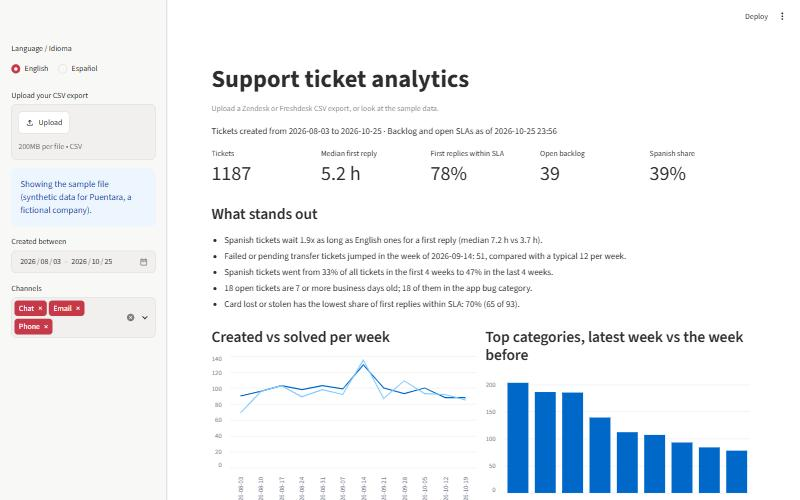
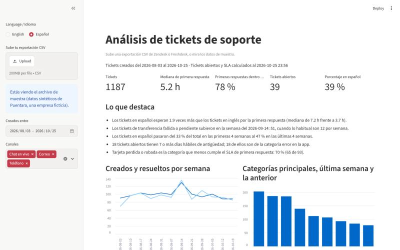

# Bilingual Ticket Analytics (EN/ES)

Turns a Zendesk or Freshdesk CSV export into a weekly support report and a small dashboard, in English or Spanish, so a support lead can see volume, slow categories, backlog and Spanish demand without rebuilding a spreadsheet every week.

> **Demo scenario.** Puentara is a fictional money app for freelancers and small businesses in the US and Latin America. Every ticket, customer and agent in this repo is synthetic, made by a seeded script. Every number below is **sample data**. The tool uses no AI: every rule is plain Python you can read.

## The problem

A support lead has a ticket export but no clear view of it. Which issues are growing? Which categories wait too long for a first reply? How old is the backlog? Do Spanish-speaking customers wait longer? Answering that by hand in a spreadsheet takes hours each week, and the result changes depending on who builds it. That makes it hard to say where a Spanish-speaking agent is needed, or to back up a hiring request.

## What it does

- **Reads a helpdesk CSV export as it is.** Columns are found by English or Spanish header names, plus common Zendesk and Freshdesk names (`Requested`, `Via`, `Resolved time`, `Satisfaction score`...). Category labels can be keys (`card_lost_stolen`), English ("Card lost or stolen") or Spanish ("Tarjeta perdida o robada").
- **Cleans it and says what it changed.** Removes duplicate ticket IDs, skips rows whose created date can't be read, fills a blank language with a simple word-count detector, and prints a data-quality note with each count.
- **Volume and top issues.** Created vs solved per week, and each category's latest week vs the week before.
- **Speed vs SLA.** Median first reply and resolution time by category, priority and language, and the share of first replies within the SLA target: urgent 60 minutes around the clock; high 4 h, normal 8 h, low 16 h in business hours (Monday to Friday, 08:00 to 18:00).
- **Category floors.** A lost or stolen card is always measured as urgent, even if the export says "low". Disputes, account access, identity checks and failed transfers are at least high. The report counts how many priorities were raised.
- **Backlog.** Open tickets by age (under 1, 1 to 3, 3 to 7, 7+ business days) and category, plus a list of open urgent tickets by ID and category.
- **Language split.** Volume, first-reply time and SLA share for English, Spanish, mixed and other; Spanish share per week; satisfaction (good/bad) by language when the export has that column.
- **"What stands out" sentences.** A few plain sentences from simple threshold rules (for example, Spanish median first reply more than 1.25x English). They describe the data. They never recommend or promise anything.
- **Two outputs from the same code.** `report.py` writes `output/summary.md`, `output/summary.html` and 10 CSV tables, no Streamlit needed. `app.py` is a Streamlit dashboard with an EN/ES switch, a file uploader, and date and channel filters.
- **English or Spanish everywhere:** console output, report, CSV column headers and dashboard. Spanish uses tú. CSVs are saved as UTF-8 with BOM so Excel shows accents and ñ correctly.

## Quick start

You need **Python 3.11 or newer** and Git. No API key and no account. Built and tested on Windows 11 with PowerShell 5.1 and Python 3.14.

> **Windows: use a short folder path.** Streamlit ships some deeply nested files. On the build machine, `pip install` failed with `WinError 206` when the project sat in a long folder path (about 120 characters before `.venv`). Clone to a short path such as `C:\dev\`, or turn on Windows long-path support (needs admin rights; search "Enable Win32 long paths").

**PowerShell (Windows)**

```powershell
git clone https://github.com/RawBud11/bilingual-ticket-analytics.git C:\dev\bilingual-ticket-analytics
cd C:\dev\bilingual-ticket-analytics
python -m venv .venv
.venv\Scripts\python -m pip install -r requirements.txt
.venv\Scripts\python report.py data/sample_export.csv --lang es
.venv\Scripts\python -m streamlit run app.py
```

These commands call the venv's Python directly, so you don't need to activate it. If you prefer to activate, run `.venv\Scripts\Activate.ps1` and then use plain `python` and `streamlit`.

**bash (macOS, Linux)**

```bash
git clone https://github.com/RawBud11/bilingual-ticket-analytics.git bilingual-ticket-analytics
cd bilingual-ticket-analytics
python3 -m venv .venv
source .venv/bin/activate
pip install -r requirements.txt
python report.py data/sample_export.csv --lang es
streamlit run app.py
```

`streamlit run app.py` opens the dashboard in your browser with the sample data loaded. Upload your own export from the sidebar.

**Run the tests**

```powershell
.venv\Scripts\python -m pytest          # bash: python -m pytest
```

137 tests passed on the build machine (2026-11-23).

**Optional settings (`.env`)**

No key is needed. Two optional settings live in `.env.example`:

```powershell
Copy-Item .env.example .env             # bash: cp .env.example .env
```

- `REPORT_LANGUAGE`: `en` or `es`, the default for the report and the dashboard's first view.
- `AS_OF`: the time used for the backlog and open SLAs, like `2026-10-26 08:00`. Empty means the latest date in the file.

**Your own export**

```powershell
.venv\Scripts\python report.py my_export.csv --lang en --as-of "2026-10-26 08:00" --out my-report
```

Only `ticket_id` and `created_at` (or their aliases) are required. Dates must look like `2026-10-23 14:05` (ISO with `T`, seconds or a zone suffix also work; the zone is ignored). A date like `23/10/2026` is skipped, not guessed, because day and month order is ambiguous. If your helpdesk uses other header names, add them to `COLUMN_ALIASES` in `config.py`.

## Example: real output on the sample data

Captured on 2026-11-23 by running the commands above on `data/sample_export.csv` (synthetic, made by `scripts/generate_data.py --seed 42`). All numbers are sample data.

**Spanish (`--lang es`)**

```
> .venv\Scripts\python report.py data/sample_export.csv --lang es
Informe de tickets de soporte
Tickets creados del 2026-08-03 al 2026-10-25
Tickets abiertos y SLA calculados al 2026-10-25 23:56

Calidad de los datos
  Filas leídas: 1201
  IDs de ticket duplicados eliminados: 10
  Filas omitidas porque no se pudo leer la fecha de creación: 4
  Fechas de primera respuesta o resolución ignoradas (no se pudieron leer o son anteriores a la creación): 0
  Idioma vacío completado por el detector: 91
  Prioridad subida al mínimo de la categoría: 6
  Tickets sin una categoría conocida: 0
  Columnas que no se usan y se quitaron al cargar: 2
  Tickets usados: 1187

Cifras clave
  Tickets: 1187
  Mediana de primera respuesta: 5.2 h
  Primeras respuestas dentro del SLA: 78 %
  Tickets abiertos: 39
  Porcentaje en español: 39 %

Lo que destaca
  - Los tickets en español esperan 1.9 veces más que los tickets en inglés por la primera respuesta (mediana de 7.2 h frente a 3.7 h).
  - Los tickets de transferencia fallida o pendiente subieron en la semana del 2026-09-14: 51, cuando lo habitual son 12 por semana.
  - Los tickets en español pasaron del 33 % del total en las primeras 4 semanas al 47 % en las últimas 4 semanas.
  - 18 tickets abiertos tienen 7 o más días hábiles de antigüedad; 18 de ellos son de la categoría error en la app.
  - Tarjeta perdida o robada es la categoría que menos cumple el SLA de primera respuesta: 70 % (65 de 93).

Listo: output/summary.md
Se guardaron 10 tablas CSV en output
Listo: output/summary.html
```

**English (`--lang en`), same file, last two sections**

```
Key numbers
  Tickets: 1187
  Median first reply: 5.2 h
  First replies within SLA: 78%
  Open backlog: 39
  Spanish share: 39%

What stands out
  - Spanish tickets wait 1.9x as long as English ones for a first reply (median 7.2 h vs 3.7 h).
  - Failed or pending transfer tickets jumped in the week of 2026-09-14: 51, compared with a typical 12 per week.
  - Spanish tickets went from 33% of all tickets in the first 4 weeks to 47% in the last 4 weeks.
  - 18 open tickets are 7 or more business days old; 18 of them in the app bug category.
  - Card lost or stolen has the lowest share of first replies within SLA: 70% (65 of 93).
```

The full English and Spanish runs are in [`docs/demo_output.txt`](docs/demo_output.txt). `output/summary.md` and `output/summary.html` add 10 tables, such as first reply by language (sample data):

| Language | Tickets | Of all tickets (%) | Answered | Median first reply (h) | SLA met (%) |
|---|---|---|---|---|---|
| English | 691 | 58.2 | 684 | 3.7 | 85.7 |
| Spanish | 459 | 38.7 | 447 | 7.2 | 64.9 |
| Mixed | 28 | 2.4 | 28 | 16.9 | 82.1 |
| Other | 9 | 0.8 | 9 | 5.0 | 100.0 |

### How to read these sample numbers

The sample data has patterns **planted on purpose** by `scripts/generate_data.py`, so the report has something to find. They are not findings about any real team:

| Planted in the generator | What the report shows |
|---|---|
| Spanish share grows from about 28% to about 50% | 33% in the first 4 weeks, 47% in the last 4 |
| Extra failed or pending transfer tickets in the week of 2026-09-14 | 51 that week vs a typical 12 |
| Spanish first replies take 1.6x as long | 1.9x (7.2 h vs 3.7 h), see below |
| A tail of old app bug tickets that are never solved | 18 open tickets 7+ business days old, all app bugs |

Planted mess for the cleaning step: 10 duplicate IDs, 4 unreadable created dates, blank languages (91 filled in), some categories written as Spanish labels, 6 lost-card tickets exported as "low" (raised to urgent), and some open tickets with no first response.

**Why 1.9x and not 1.6x?** The generator makes Spanish replies 1.6x slower on each priority's own clock. For high, normal and low tickets that clock is business hours. The report measures first reply in **wall-clock** hours from creation, because that is what the customer actually waited. A longer business-hours delay is more likely to cross 18:00 or a weekend, and those nights and weekends get added to the wall-clock wait. So the planted 1.6x shows up as 1.9x.

**The lost-card line is not a finding.** "Card lost or stolen has the lowest share of first replies within SLA: 70%" was not planted. Lost cards always get the strictest target (60 minutes, nights and weekends included). The generator places most replies at 10% to 85% of the target and then multiplies Spanish waits by 1.6, so a Spanish lost-card reply misses whenever it would otherwise land after about 37 minutes. That side effect pulls the share down. Tax forms is at 71%, almost the same, so the ranking itself means little here.

## Screenshots

The dashboard with the sample data (synthetic data for Puentara, a fictional company).





## How it works

`analytics/load.py` reads the CSV, matches column names from `config.py`, cleans the rows and keeps only the columns it needs; ticket text is used only to fill a blank language and then dropped. `analytics/sla.py` does the business-hours math. `analytics/metrics.py` builds every table with pandas group-bys, `analytics/insights.py` turns them into "what stands out" sentences with fixed thresholds, and `analytics/strings.py` holds every label in English and Spanish. `report.py` writes the Markdown, HTML and CSV files; `app.py` is a thin Streamlit layer over the same functions, so the dashboard and the report always agree.

```
CSV export -> load.py (clean, data-quality note) -> metrics.py (tables) -> insights.py (sentences)
                                                                       -> report.py (md, html, csv)
                                                                       -> app.py (dashboard)
```

How it measures: first reply and resolution are wall-clock hours from creation. "Within SLA" uses each priority's clock and counts answered tickets plus unanswered tickets already past their target at the "as of" time. Unanswered tickets still inside their target are not counted yet.

## Safety and support rules

- **No ticket text in any output.** Reports, CSVs and the dashboard show counts, times, ticket IDs and categories only. Subjects and bodies are never shown. A test feeds tickets with a fake card number, a CVV and a one-time code in the text and checks that none of them appears in `summary.md`, `summary.html`, any CSV, the console output or the rendered dashboard.
- **Customer IDs, emails and agent names are dropped on load.** Any column not in `config.py` is removed before any math. The dashboard has no per-agent rankings.
- **Ticket IDs are shown as exported.** The "open urgent tickets" list shows your helpdesk's own ticket IDs (for example `PT-11138`), so a lead can open them. Keep that in mind before sharing a report outside the team.
- **Lost cards stay urgent.** The category floor applies whatever the export says, and the report counts how often a priority was raised.
- **Describes, never promises.** A test checks the English and Spanish sentence templates for words like "reduce", "improve by" or "guarantee".
- **Works offline.** No AI, no API calls. `.streamlit/config.toml` turns off Streamlit's usage statistics.
- This is a demo project. It does not claim any compliance certification.

## Limitations and next steps

- Reads CSV exports only. It does not connect to the Zendesk or Freshdesk API. Exporting a CSV needs no admin keys, which is often easier for a small team.
- One business-hours setting for the whole team: no holiday calendar, no per-team time zones.
- Medians are wall-clock only. A business-hours median as a second column would make the SLA tables easier to compare.
- It does not read Zendesk's "First reply time in minutes" column when there is no first-reply timestamp.
- The HTML summary has tables only, no charts. Charts are in the dashboard.
- Day-first dates like `23/10/2026` are skipped, not guessed.
- Spanish numbers use a decimal point ("5.2 h"), which reads naturally in Mexico but not in Colombia or Argentina.
- Blank channels show as "Other" / "Otro" in the channel filter, and the browser tab title stays in English in Spanish mode.

## Project layout

```
report.py            command-line report (md, html, csv)
app.py               Streamlit dashboard
config.py            categories, SLA targets, business hours, column aliases, thresholds
analytics/           load, sla, metrics, insights, present, strings, language, mask
scripts/             generate_data.py (seeded sample data), ticket_templates.py
data/                sample_export.csv (about 1,200 tickets), tiny_export.csv (about a dozen hand-checked rows for tests)
tests/               pytest suite, including Streamlit AppTest smoke tests in EN and ES
docs/                demo_output.txt (captured output)
```

Rebuild the sample data with `python scripts/generate_data.py --seed 42`.

## Tools used

Python, pandas and Streamlit (built-in charts only), python-dotenv, pytest. No database, no plotting library beyond Streamlit's own.

## Fictional data

Puentara is a fictional company. All tickets, customers, agents (Sam Demo, Jordan Demo, Mateo Demo) and card numbers are synthetic. Fake card numbers start with `0000`, which no real card does.

## How this was built

Built with AI-assisted development tools; I planned, reviewed and tested it.

## License

MIT. See [LICENSE](LICENSE).
